# 🎬 Awesome Automated Test Video & Screen Capture 📹

> A curated collection of screen recording software, automated test video capture frameworks, asynchronous video messaging platforms, and high-performance open-source recording utilities.

  
  
  
  
  
  

  <b>Explore:</b>
  <a href="#-sector-overview--market-dynamics">📈 Sector Overview</a> •
  <a href="#-saas--commercial-platforms">💼 SaaS Platforms</a> •
  <a href="#-open-source-screen-recording--capture-tools">🚀 Open-Source Tools</a> •
  <a href="#-key-selection-criteria">🎯 Selection Criteria</a> •
  <a href="#-star-history">⭐ Star History</a> •
  <a href="#-support--sponsor">💖 Support</a>

---

## 📈 Sector Overview & Market Dynamics

The global screen recording and video capture software market is estimated between **$2.1 billion and $2.5 billion**, expanding at a compound annual growth rate (CAGR) of approximately **11% to 18%**. The sector is **moderately fragmented** rather than winner-take-all, characterized by a diverse mix of enterprise cloud video messaging tools, dedicated professional video editing suites, lightweight freemium browser extensions, and dominant open-source utilities serving distinct niches (software testing, customer communication, and creator workflows).

---

## 💼 SaaS & Commercial Platforms

| Platform | Category | Company Scale (Valuation / Revenue) | Starting Tier Pricing | Free Tier / Trial Limits |
| :--- | :--- | :--- | :--- | :--- |
| **BrowserStack (Bug Capture)** | 🧪 Automated & Manual Bug Capture | **$4 Billion** valuation (~$225M ARR) | **$29/user/month** (billed annually at $348/yr for Live desktop plan) | Free trial only: 30 mins Live testing, 60–100 mins Automate, 100 screenshots; 2-min max continuous replay / 20-min live session |
| **Loom** | 💬 Async Video Messaging | **$975 Million** acquisition exit by Atlassian (~$50M ARR) | **$12.50/creator/month** billed annually ($15/mo billed monthly for Starter); Business + AI is **$24/user/month** | Free forever: Up to 25 videos/creator total library limit, 5-minute maximum recording length per video |
| **Camtasia (TechSmith)** | 🎞️ Screen Recording & Video Editing | **~$50M–$70M+** ARR (TechSmith; Bootstrapped/Private) | **$196.07/year** (Essentials plan; equivalent to ~$16.34/mo) | Free trial only: No time limit (indefinite evaluation), but all video exports include a prominent TechSmith watermark |
| **Vidyard** | 📢 Video Messaging & Video Hosting | **~$30M–$50M** ARR ($90M+ VC funding) | **$59/seat/month** billed annually ($89/seat/month billed monthly) | Free forever: 5 recorded videos per month (resets monthly; non-expiring library), 15 total lifetime AI videos, up to 3 custom AI avatars |
| **Soapbox (Wistia)** | 🎯 Video Recording & Marketing Hosting | **~$67M** ARR (Wistia; $17.3M debt-financed buyout) | **$79/month** billed annually (Wistia Pro tier with native recorder) | Free forever: 1 user, up to 25 GB storage (historically capped at ~10 videos), Wistia-branded player (Standalone Soapbox retired/integrated into Wistia Record) |
| **Zight (formerly CloudApp)** | 🔍 Visual Communication & Screen Capture | **~$4M–$5M** ARR ($21M VC funding) | **$9.95/month** billed annually ($12.95/month billed monthly for Create tier) | Free forever: Up to 5 minutes per video, 720p max resolution, access limited to the most recent 25 items (videos/screenshots/GIFs) |
| **ScreenPal (formerly Screencast-O-Matic)** | 🖥️ Screen Recording & Editing | **~$3.8M** ARR (Bootstrapped/Private) | **$4.00/month** billed annually ($48/year for Solo Deluxe tier) | Free forever: Up to 15 minutes per video, max 10 hosted videos on cloud CMS, includes ScreenPal watermark on exports |
| **Screencastify** | 🌐 Browser Screen Recorder | **~$1.3M+** ARR (Series A-backed) | **$7.00/user/month** billed annually ($18–$24/user/month billed monthly for Starter tier) | Free forever: Up to 30 minutes per video, max active library of 10 videos, 10GB storage |
| **Berrycast** | 🎙️ Async Video Messaging | **~$220K** ARR (Bootstrapped/Private) | **$16.00/user/month** billed annually ($192/year for Starter tier) | Free trial only: 14-day fully featured trial with unlimited recording, no credit card required upfront |

---

## 🚀 Open-Source Screen Recording & Capture Tools

A sorted ranking of leading open-source screen recording software, developer libraries, and screen capture tools, ordered in descending order by GitHub stargazers.

| Project & Repo Link | Stars_Count | License | Platforms | Description & Highlights |
| :--- | :--- | :--- | :--- | :--- |
| **OBS Studio** [`obsproject/obs-studio`](https://github.com/obsproject/obs-studio) |  | GPL-2.0 | Windows, macOS, Linux | Dominant open-source broadcast, screen capture, and recording suite. Features high-performance real-time video/audio capturing, scene composition, and plugin extensibility without limits. |
| **ShareX** [`ShareX/ShareX`](https://github.com/ShareX/ShareX) |  | GPL-3.0 | Windows | Legendary free and open-source screen capture, file sharing, and productivity tool. Supports screen recording (FFmpeg/GIF), scrolling capture, annotations, and automated upload workflows. |
| **Flameshot** [`flameshot-org/flameshot`](https://github.com/flameshot-org/flameshot) |  | GPL-3.0 | Linux, macOS, Windows | Powerful yet simple-to-use screenshot and capture software with in-app annotations, arrows, blur, pin-to-screen, and CLI scriptability for automated workflows. |
| **Cap** [`CapSoftware/Cap`](https://github.com/CapSoftware/Cap) |  | AGPL-3.0 | macOS, Windows, Web | Open-source Loom alternative. Lightweight, beautiful, and shareable instant screen recordings with self-hosting support and modern web sharing interfaces. |
| **Screego** [`screego/server`](https://github.com/screego/server) |  | GPL-3.0 | Cross-platform / WebRTC | Screen sharing for developers. Self-hosted WebRTC room screen-sharing server with multi-user viewing, low latency, and end-to-end encryption. |
| **Peek** [`phw/peek`](https://github.com/phw/peek) |  | GPL-3.0 | Linux | Simple animated GIF, APNG, and WebM screen recorder with an intuitive UI specifically tailored for creating concise screencasts of UI bugs and demos. |
| **LICEcap** [`justinfrankel/licecap`](https://github.com/justinfrankel/licecap) |  | GPL-2.0 | Windows, macOS | Lightweight animated screen capture utility that records desktop activity directly to `.GIF` files with low CPU overhead and pause-and-resume capability. |
| **Snapzy** [`duongductrong/Snapzy`](https://github.com/duongductrong/Snapzy) |  | MIT | macOS | Native macOS screenshot and screen recording application built with Swift and SwiftUI; modern open-source alternative to proprietary desktop capture suites. |
| **ksnip** [`ksnip/ksnip`](https://github.com/ksnip/ksnip) |  | GPL-3.0 | Linux, Windows, macOS | Cross-platform Qt-based screenshot tool that provides extensive drawing, watermarking, custom crop zones, and command-line screenshot capture. |
| **MediaStreamRecorder** [`streamproc/MediaStreamRecorder`](https://github.com/streamproc/MediaStreamRecorder) |  | MIT | Web / JavaScript | Cross-browser HTML5 / WebRTC audio, video, and screen recording library supporting Chrome, Firefox, Opera, and Microsoft Edge for automated web test capture. |
| **screen-capture-recorder** [`rdp/screen-capture-recorder-to-video-windows-free`](https://github.com/rdp/screen-capture-recorder-to-video-windows-free) |  | MIT / LGPL | Windows | Free open-source DirectShow Windows screen capture driver and audio recorder used widely with FFmpeg, VLC, and headless testing pipelines. |
| **maim** [`naelstrof/maim`](https://github.com/naelstrof/maim) |  | GPL-3.0 | Linux | High-performance CLI desktop capture utility designed to overcome limitations of legacy tools; integrates seamlessly with slop for rectangular coordinate selection. |
| **vokoscreenNG** [`vkohaupt/vokoscreenNG`](https://github.com/vkohaupt/vokoscreenNG) |  | GPL-2.0 | Linux, Windows | Open-source screencast creator supporting multi-source audio, webcam overlays, magnification, area capture, and hardware-accelerated video codecs. |
| **wcap** [`mmozeiko/wcap`](https://github.com/mmozeiko/wcap) |  | MIT | Windows (10/11) | Ultra-compact (~100 KB) C-based Windows screen recording utility utilizing modern Windows Graphics Capture APIs with hardware-accelerated H.264/H.265 encoding. |
| **XCap** [`nashaofu/xcap`](https://github.com/nashaofu/xcap) |  | Apache-2.0 / MIT | Linux, macOS, Windows | Cross-platform Rust screen and window capture library designed for developers building automated testing agents and custom desktop capture clients. |
| **grim** [`emersion/grim`](https://github.com/emersion/grim) |  | MIT | Linux (Wayland) | Grab images directly from Wayland compositors via `wlr-screencopy-unstable-v1` protocol; fast, lightweight, and ideal for headless test suites. |
| **scrot** [`resurrecting-open-source-projects/scrot`](https://github.com/resurrecting-open-source-projects/scrot) |  | MIT / BSD | Linux (X11) | Classic, minimalist command-line screen capture utility with formatting options, delay triggers, and thumbnail generation. |

---

## 🎯 Key Selection Criteria

When deciding between tools for automated testing, developer workflows, or corporate communication:

1. **🧪 Automated Testing & Headless Pipelines**: Look for CLI-first tools (`grim`, `maim`, `wcap`, `screen-capture-recorder`) or programmatic SDKs (`nashaofu/xcap`, `MediaStreamRecorder`) that can be invoked via CI/CD runners or headless Docker containers.
2. **💬 Team Collaboration & Async Video Messaging**: Platforms like **Loom**, **Cap**, or **Vidyard** are optimized for quick link generation, player hosting, and team notifications.
3. **📊 Enterprise QA & Bug Tracking**: Tools like **BrowserStack Bug Capture** excel by bundling DOM inspection, network telemetry, console logs, and reproducible session replays directly with bug tickets.
4. **🎥 Professional Production & Tutorials**: Desktop-grade editors like **Camtasia** and **OBS Studio** provide granular multi-track timeline editing, audio equalization, and high-fidelity local rendering.

---

## ⭐ Star History

---

## 💖 Support & Sponsor

Thank you for exploring this curated repository! If you found this resource helpful for your projects, test automation stacks, or team workflows, please consider:

- ⭐ **Starring this repository** on GitHub to help others discover it.
- 🍴 **Forking and contributing** your favorite tools and libraries via pull requests.
- 📢 **Sharing this list** on Twitter/X, LinkedIn, Reddit, or developer Discord communities.
- ☕ **Sponsoring or buying a coffee** via the [GitHub Sponsor Dashboard](https://github.com/sponsors/ishandutta2007).

Your support keeps open-source research and curated resources up-to-date and thriving! 🙌
